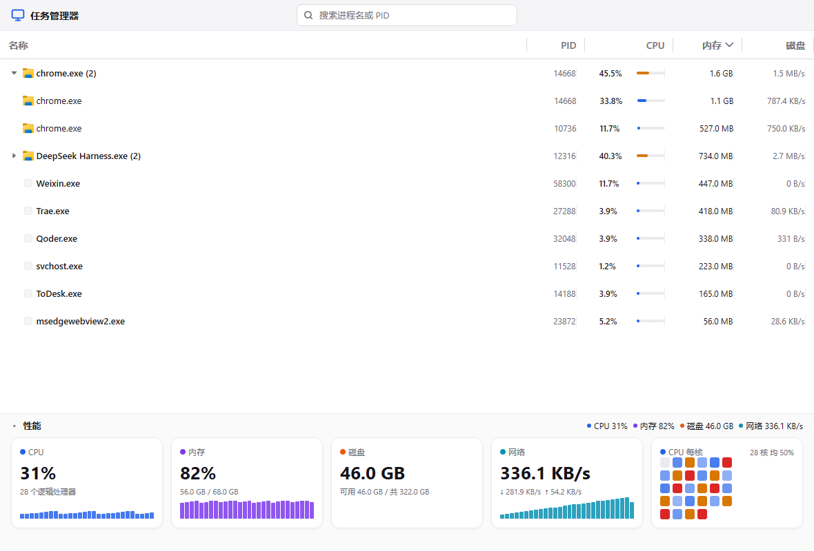
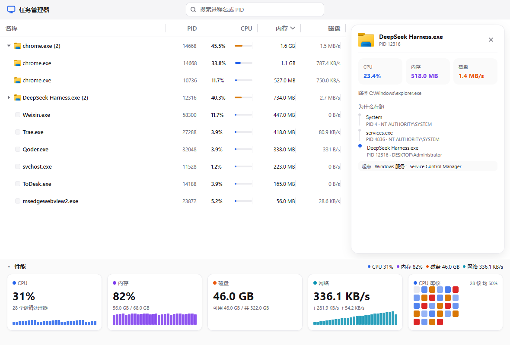
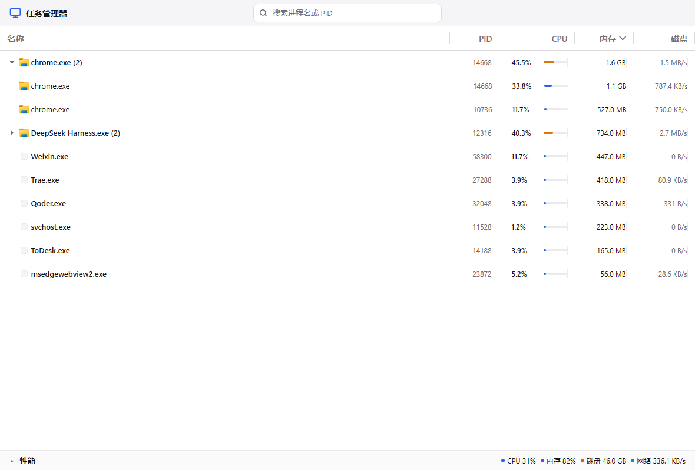

# gogo-explorer

> A native Windows Task Manager, rebuilt as a single-window Go desktop app — live process table, system performance strip, and "why is this running?" ancestry tracing.

[](https://go.dev/)
[](https://www.microsoft.com/windows)
[](https://github.com/egoist/mygo)
[](LICENSE)

gogo-explorer is a from-scratch, opinionated take on the Windows Task Manager. There is no sidebar and no tab bar: the process table **is** the main screen. Select a row and a detail card slides in from the right with the facts about that process — and, uniquely, an explanation of **why it is running**, traced back through its parent ancestry to the Windows service, scheduled task or shell that actually started it.

---

## Powered by MyGo

> **The entire user interface of this application is built with [MyGo](https://github.com/egoist/mygo) — a Go-native desktop UI toolkit — pinned to `v0.3.5` in [go.mod](go.mod).**

This is not a wrapper around an embedded browser, and there is no web view, no JS runtime and no CGO UI toolkit underneath. Every pixel — the custom title bar, the sortable/resizable process table, the CPU sparklines, the per-core grid, the SVG icons and the detail panel — is composed with the declarative, retained-mode widget API of the `github.com/egoist/mygo/ui` package and rendered natively on Windows.

- Upstream project: <https://github.com/egoist/mygo>
- Module: `require github.com/egoist/mygo v0.3.5`
- Build tool directive: `tool github.com/egoist/mygo/cmd/mygo` (see [Build & Run](#build--run))
- Widgets used: `mygo.NewWindow` / `mygo.App` lifecycle, `ui.Column` / `ui.Row` / `ui.Box` layout, `ui.Table`, `ui.TextInputBase`, `ui.Icon` + `ui.MustParseSVG`, `ui.Theme` design tokens, `ui.Context.TitleBar`

MyGo's lifetime, threading and identity rules shaped the architecture of this app — in particular, all UI mutation happens on the main thread via `Window.Update`, and background sampling goroutines only ever hand results back through that one entry point.

---

## Screenshots

### Process table

The main screen: same-name processes are merged into one row like the built-in Task Manager does, each row carries the real executable icon, and the CPU column has an inline mini-bar so that "idle" reads as an empty track rather than a missing widget.



### Process detail + "why is this running?"

Select a process and the panel on the right shows its facts together with the causal chain produced by `witr` — here `System → services.exe → app`, with the origin labelled as a Windows service.



### Collapsed performance strip

The bottom performance strip is always visible and can be collapsed down to a single summary line that keeps the live CPU / memory readout.



---

## Features

- **Whole-window process table** — the app opens straight into the list; no sidebar, no dashboards, no tabs.
- **Live sampling at 1 Hz** — per-process CPU, private working set and disk I/O, plus machine-wide CPU, memory, disk and network. Sampling ~500 processes takes about 4 ms.
- **Task-Manager-compatible CPU accounting** — per-process CPU is expressed as a share of total machine capacity, so summing the column approximates the machine-wide figure.
- **Accurate per-process memory** — reads the Windows `\Process(*)\Working Set - Private` counter instead of naively summing `GetProcessMemoryInfo` working sets, which over-reports by ~1.6× when many processes share code pages.
- **Grouping and expansion** — processes with the same image name collapse into one row; expand a row to see the individual PIDs under it.
- **Sort, resize, reorder** — click any header to sort (ascending/descending), drag column edges to resize, drag headers to reorder. The sort state lives in the table and is read back, never overwritten.
- **Real executable icons** — every row shows the icon extracted from the process's `.exe`, cached per executable path.
- **Search** — filter by process name or PID from the title-bar search box, with hover / focus / has-content visual states.
- **Detail panel** — per-process facts plus the `witr` causal chain, restart count, warnings and candidate processes.
- **Performance strip** — four metric cards (CPU / memory / disk / network) with live sparklines, a per-core CPU grid, and a collapsible summary row.
- **Light theme, always** — a fixed light appearance regardless of the system's dark-mode setting, so the app looks identical everywhere.
- **Zero third-party Go dependencies for the Win32 work** — process enumeration, performance counters and icon extraction all go through `syscall` / `NewLazyDLL` against documented Windows APIs.

---

## Architecture

The program is a single `main` package split into one file per concern. Data collection never touches the UI; views only read state.

| File | Responsibility |
| --- | --- |
| [main.go](main.go) | Entry point. Creates the MyGo window (title 任务管理器, 1180×760, min 820×560, hidden native title bar with 40 px of custom chrome) and the app state. |
| [shell.go](shell.go) | Window shell and custom title bar: app name, centred search box, hairline separator, drag-to-move region. |
| [table_ui.go](table_ui.go) | The process table slice: columns, CPU mini-bars, zebra rows, empty state, sorting/resizing wiring. |
| [perf_ui.go](perf_ui.go) | Bottom performance strip: metric cards, sparklines, per-core CPU grid, collapse behaviour. |
| [detail_ui.go](detail_ui.go) | Right-hand detail panel: process facts and the `witr` ancestry chain. |
| [taskmgr.go](taskmgr.go) | Table data model and shared pure helpers (row flattening, sorting, group aggregation, labels). |
| [taskmgr_state.go](taskmgr_state.go) | All application state plus the background sampling loop and history buffers. |
| [procs.go](procs.go) | Process enumeration via a Toolhelp32 snapshot, executable path lookup, and the process list filter. |
| [perf.go](perf.go) | Machine-wide and per-process counters via Win32 APIs; diffing of cumulative CPU/disk counters at a 1 s interval. |
| [memsampler.go](memsampler.go) | Per-process private working set via the PDH `Working Set - Private` counter. |
| [percpu.go](percpu.go) | Per-logical-core CPU utilisation via PDH `\\Processor(*)\\% Processor Time`. |
| [witr.go](witr.go) | Data layer for `witr` ("Why is this running?"): subprocess execution, exit-code dispatch, JSON parsing. |
| [icons.go](icons.go) | Per-executable icon extraction and cache (ExtractIconExW → DrawIconEx into a DIBSection → RGBA). |
| [tokens.go](tokens.go) | Design tokens: radii, spacing, row heights, type scale and every colour in the app. |
| [helpers.go](helpers.go) | Small shared utilities: main-thread dispatch, byte/rate formatting, warning localisation. |

### How sampling works

A single background goroutine samples on a 1-second tick. It never touches UI state directly: it posts a closure back to the main thread through `Window.Update` (or a synchronous hook in tests), which is the only place state is written. Cumulative counters (CPU ticks, disk bytes) are stored raw and differenced between samples; metrics that need no delta, such as memory, are available on the very first frame.

### Why `witr` is called as a subprocess

`witr`'s implementation lives entirely under `internal/` (`pipeline`, `proc`, `source`, `target`), and Go forbids importing another module's `internal` packages; its `pkg/` tree exposes types only. gogo-explorer therefore shells out to the `witr` binary, enforces a 30-second timeout, and parses its `--json` output — re-declaring only the fields the UI needs so that `witr`'s own dependency tree stays out of this module.

Because it is only ever a subprocess, bundling it costs nothing structurally: the binary simply sits in `resources/` and is resolved from the install directory (see [witr.go](witr.go)) — no `go:embed`, and no unpacking to a temp directory at startup.

---

## Requirements

- **Windows 10 or Windows 11** (x64). The app depends on Win32 APIs and will not build on other platforms.
- **Go 1.27.1 or newer** (see [go.mod](go.mod)).
- **`witr` — bundled, nothing to install.** The "why is this running?" ancestry trace shells out to [witr](https://github.com/pranshuparmar/witr), which ships with the app as `resources/witr.exe`. `mygo build` copies everything in `resources/` next to the executable, so installed builds already have it in the install directory. Resolution order is: an explicit override, then `witr.exe` next to the executable, then `witr` on `PATH` (a `winget install PranshuParmar.witr` copy is still picked up for development runs). If all three miss, the detail panel still shows process facts and reports that the trace could not be resolved.

---

## Build & Run

`mygo.json` configures the MyGo build tool; there is no `Makefile` and no extra tooling to install beyond Go itself.

```powershell
# Development run (hot reload)
go run .

# Build a release executable into build/ (output dir comes from mygo.json)
go tool mygo build

# Or build with the standard toolchain
go build -o build\gogo-explorer.exe .
```

The window can also be started by double-clicking the produced executable — it is a plain, self-contained Windows binary.

### Continuous integration

CI is defined in `.github/workflows/` and runs on `windows-latest` (the app is Win32-only):

- **[ci.yml](.github/workflows/ci.yml)** runs on every push and pull request to `main`, plus manual dispatch. It verifies `go.mod`/`go.sum` are tidy, runs `go tool mygo vet .` and `CGO_ENABLED=0 go test ./...`, then builds with `go tool mygo build` and asserts the expected output (`gogo-explorer.exe`, `witr.exe`, and the installer) actually landed in `build/windows-amd64/`. Artifacts are uploaded for 14 days.
- **[release.yml](.github/workflows/release.yml)** runs when a `v*` tag is pushed (or via manual dispatch with a tag input). It re-runs the tests, builds, checks the tag matches `version` in `mygo.json`, and publishes the executables plus the installer as GitHub Release assets.

To cut a release, bump `version` in `mygo.json` first — the workflow rejects a tag that disagrees with it:

```powershell
# mygo.json version must already read 0.2.0
git tag v0.2.0
git push origin v0.2.0
```

### Project configuration

```json
{
  "name": "gogo-explorer",
  "identifier": "com.sugarbearr.gogo-explorer",
  "version": "0.1.0",
  "out": "build"
}
```

---

## Testing

All tests run headless on the Windows host — no window is created. `ui.NewTester` builds the view off-screen and lets tests assert on rendered text and drive clicks, while a synchronous post hook makes the otherwise-asynchronous sampling and tracing pipelines fully deterministic in tests.

```powershell
go test ./...
go test -run TestGrouping -v ./...
go vet ./...
```

| Test file | Covers |
| --- | --- |
| [main_test.go](main_test.go) | Window shell: title bar present, old sidebar gone, performance strip collapse. |
| [taskmgr_test.go](taskmgr_test.go) | Grouping, sorting, selection, detail opening, the async post pipeline. |
| [taskmgr_sort_test.go](taskmgr_sort_test.go), [taskmgr_click_test.go](taskmgr_click_test.go) | Header click → sort order, hit-testing on the table. |
| [taskmgr_expand_test.go](taskmgr_expand_test.go) | Expanding a same-name group into individual processes. |
| [procs_test.go](procs_test.go), [procs_filter_test.go](procs_filter_test.go) | Process enumeration and query filtering. |
| [perf_test.go](perf_test.go), [perf_scale_test.go](perf_scale_test.go), [percpu_test.go](percpu_test.go), [memsampler_test.go](memsampler_test.go) | Counter diffing, sampling under load, per-core and memory samplers. |
| [icons_test.go](icons_test.go), [icons_size_test.go](icons_size_test.go) | Icon extraction and rendered icon dimensions. |
| [witr_test.go](witr_test.go) | `witr` invocation, exit-code handling and JSON parsing. |

---

## Credits

- **UI toolkit:** [MyGo](https://github.com/egoist/mygo) (`v0.3.5`) by [egoist](https://github.com/egoist) — the native Go UI framework this entire interface is built on.
- **Ancestry tracing:** [witr](https://github.com/pranshuparmar/witr) — "Why is this running?", used to reconstruct a process's causal chain.
- **Design references:** the Windows Task Manager for behaviour and information architecture, and the project's own design notes under [docs/plans](docs/plans).
- **Author:** sugarbear.

## License

Released under the [MIT License](LICENSE). Copyright (c) 2026 sugarbear.

---

## 中文简介

**gogo-explorer** 是一个用 Go 从零重写的 Windows 任务管理器，界面完全基于 [MyGo](https://github.com/egoist/mygo)（`v0.3.5`）这一原生 Go UI 框架构建——没有内嵌浏览器，没有 WebView，所有控件都由 MyGo 的 `ui` 包声明式地搭建并在 Windows 上原生渲染。

整窗就是一张进程表，没有侧边栏：选中的进程会在右侧展开详情，并且额外回答一个问题——**「它为什么在跑」**。通过 `witr` 把进程回溯到完整的启动因果链（例如 `System → services.exe → 应用`），能直接看出它是由 Windows 服务、计划任务还是某个 Shell 拉起来的。

**主要功能**

- 每秒一次实时采样：每进程 CPU / 内存 / 磁盘，整机 CPU / 内存 / 磁盘 / 网络
- 同名进程自动合并为一行，可展开查看每个 PID
- 表头点击排序、列宽拖动、列序拖动；CPU 列带迷你条
- 真实可执行文件图标（按 exe 路径缓存）、按进程名或 PID 搜索
- 右侧详情面板 + `witr` 溯源链；底部性能区可折叠，含四张指标卡、曲线与每核 CPU 网格
- 固定浅色主题，设计令牌集中在 `tokens.go`

**构建与运行**

```powershell
go run .                        # 开发运行
go tool mygo build              # 打包到 build/（配置见 mygo.json）
go test ./...                   # 无头测试
```

**环境要求**：Windows 10/11 x64、Go 1.27.1+。溯源功能用的 `witr` 已随程序内置（`resources/witr.exe`，由 `mygo build` 复制到安装目录），无需单独安装；查找顺序为「显式覆盖 → 可执行文件同目录 → `PATH`」，开发机上 winget 装的那份仍然可用。

**许可证**：MIT，作者 sugarbear。
